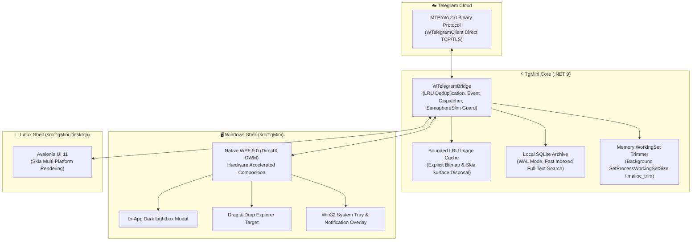

# ⚡ TgMini — High-Performance Lightweight Telegram Desktop Client

<div align="center">

[](https://dotnet.microsoft.com/)
[](https://docs.microsoft.com/dotnet/csharp/)
[](#-project-architecture)
[](#-performance--resource-benchmarks)
[](https://github.com/frontys/TgMini/releases/latest)
[](LICENSE)

<p align="center">
  <b>A portable, lightning-fast Telegram client engineered for minimal resource consumption and zero bloat.</b><br>
  Built with C# .NET 9, native Windows Presentation Foundation (WPF) with DirectX DWM composition, and Avalonia UI 11 for Linux.
</p>

[Downloads](#-downloads--releases) •
[Features](#-key-features) •
[Architecture](#-project-architecture) •
[Benchmarks](#-performance--resource-benchmarks) •
[Build Guide](#-building-from-source) •
[License](#-license)

</div>

---

## 📥 Downloads & Releases

**[⬇️ Download Latest TgMini Release (Windows & Linux)](https://github.com/frontys/TgMini/releases/latest)**

| Package | Target OS | Format | Architecture |
| :--- | :--- | :--- | :--- |
| `TgMini.exe` | **Windows 10 / 11** | Single-File Standalone Binary | x64 |
| `TgMini-v1.0.7-linux-x64.tar.gz` | **Linux (Ubuntu, Debian, Fedora, Arch)** | Standalone Executable Package | x64 |

> [!NOTE]
> **Zero Dependencies:** Fully self-contained single-file deployments. No separate .NET runtime, C++ redistributables, or installers required.

---

## 🌟 Key Features

### 🚀 Performance & Resource Efficiency
- **Ultra-low RAM Footprint (~35–50 MB idle):** Compared to 300–500 MB in standard Qt/Electron desktop messengers.
- **Active WorkingSet Trimming:** Background non-blocking memory compaction using `SetProcessWorkingSetSize` (Windows) and `malloc_trim` (Linux).
- **Bounded LRU Image Caching:** Strict memory boundaries for avatars and photo thumbnails with explicit Skia / DirectX surface disposal.
- **Instant Cold Start (< 0.6s):** File-backed single-file mmap with zero runtime unpacking delay.

### 💬 Modern Telegram-Grade Messaging UX
- **In-App Dark Lightbox Viewer (v1.0.7):** Click any image to view it in an in-window dark translucent overlay with smooth scaling, resolution & file size metadata, and one-click direct save.
- **Drag & Drop File Uploads:** Drop files directly into conversations with visual drop-zone feedback and real-time upload progress.
- **Duplicate Prevention & Concurrency Guard:** 1000-entry LRU message tracking preventing duplicate MTProto events; `UpdateEditMessage` and link previews update in-place without phantom notifications.
- **Telegram Dark Palette:** Pixel-accurate `#2B5278` / `#182533` styling, asymmetric bubbles, double-check `✓✓` delivery receipts, floating date dividers, and custom 6px minimalist dark scrollbar.
- **Chat Folder Synchronization:** Reactive tab switching between All, Personal, Work, and Custom Telegram folders with instant cache lookup.

### 🛡️ Privacy, Auth & Background Operation
- **Instant QR Code & Cloud 2FA Login:** Authorize via the official mobile app camera with built-in modal 2FA password verification and flood-wait protection.
- **Gaming Notification Overlay:** Non-intrusive floating overlay for full-screen gaming or coding sessions with Quiet Mode (DND).
- **System Tray & Global Hotkeys:** Minimize to system tray with unread badge counter; hotkeys `Win+H` (toggle), `Win+J` (minimize), and `Win+M` (mute).
- **Offline WAL-Mode SQLite Archive:** Fast local message history cache powered by SQLite with Write-Ahead Logging.

---

## 🏗️ Project Architecture



---

## 📊 Performance & Resource Benchmarks

Tested on Windows 11 Pro 64-bit (Intel Core i5, 16GB RAM):

| Metric | **TgMini (.NET 9)** | Official Telegram Desktop (Qt) | Webogram / Browser Tab |
| :--- | :---: | :---: | :---: |
| **Idle Memory (RAM)** | ⚡ **38 – 52 MB** | ❌ 260 – 420 MB | ❌ 450 – 850 MB |
| **Cold Startup Time** | ⚡ **~0.58 s** | ⚠️ 2.4 s | ⚠️ 3.8 s |
| **Binary Deployment** | 📦 **Single .exe (self-contained)** | Multi-file installer | Browser runtime required |
| **Graphics Pipeline** | 🚀 **DirectX DWM Hardware Composition** | Qt OpenGL / ANGLE | Chromium Blink / Skia |
| **Background Resource Trimming** | ✅ **Automatic WorkingSet Compaction** | ❌ Keeps memory committed | ❌ Dependent on browser GC |
| **In-App Lightbox & Drag-Drop** | ✅ **Built-in (v1.0.7)** | ✅ Built-in | ⚠️ Limited web APIs |

---

## 📱 QR Code Authentication

```
+-------------------------------------------------------+
|  Scan QR code with Telegram                           |
|                                                       |
|        ███████████████████████████████                |
|        ███████████████████████████████                |
|        ████ ▄▄▄▄▄ █▀▄█▀▄█ ▄▄▄▄▄ ████                |
|        ████ █   █ █ █ █ █ █   █ ████                |
|        ████ █▄▄▄█ █▀▄ █ █ █▄▄▄█ ████                |
|        ████▄▄▄▄▄▄▄█▄▀ ▀▄█▄▄▄▄▄▄▄████                |
|        ████▄▄▄▄▄▄▄▄▄▄▄▄▄▄▄▄▄▄▄▄▄████                |
|                                                       |
|  1. Open Telegram on your phone                       |
|  2. Go to Settings -> Devices -> Link Desktop Device  |
|  3. Point your camera at this screen                  |
+-------------------------------------------------------+
```

1. Launch `TgMini.exe` — the QR authentication dialog generates automatically.
2. Open Telegram on your mobile device: **Settings** ➔ **Devices** ➔ **Link Desktop Device**.
3. Scan the code to authenticate immediately. If Cloud 2FA is active, an in-app password modal will prompt for verification.

---

## 🛠️ Building from Source

### Prerequisites
- [.NET 9.0 SDK](https://dotnet.microsoft.com/download/dotnet/9.0) (x64)
- Git

### Build Instructions

```powershell
# Clone the repository
git clone https://github.com/frontys/TgMini.git
cd TgMini

# Restore solution packages
dotnet restore TgMini.sln

# Build entire solution in Release configuration
dotnet build TgMini.sln --configuration Release
```

### Publish Single-File Standalone Binaries

```powershell
# Windows x64 (Self-Contained Single-File Executable)
dotnet publish src/TgMini/TgMini.csproj `
  -c Release `
  -r win-x64 `
  --self-contained true `
  -p:PublishSingleFile=true `
  -p:IncludeNativeLibrariesForSelfExtract=true `
  -o dist_win

# Linux x64 (Avalonia UI Standalone Executable)
dotnet publish src/TgMini.Desktop/TgMini.Desktop.csproj `
  -c Release `
  -r linux-x64 `
  --self-contained true `
  -p:PublishSingleFile=true `
  -o dist_linux
```

---

## 📂 Project Architecture & Components

```
TgMini/
├── src/
│   ├── TgMini/                  # Native Windows WPF application (.NET 9)
│   │   ├── MainWindow.xaml      # Core chat feed, folder bar, input area, FAB
│   │   ├── NotificationWindow   # Floating gaming notification overlay
│   │   ├── QrWindow.xaml        # Responsive QR code authentication modal
│   │   └── TrayHelper.cs        # Win32 notify icon, unread badge, global hotkeys
│   ├── TgMini.Desktop/          # Cross-platform Linux Avalonia UI 11 application
│   │   ├── MainWindow.axaml     # Avalonia reactive desktop shell
│   │   └── VerificationWindow   # Cloud 2FA verification dialog
│   └── TgMini.Core/             # Shared engine library
│       ├── WTelegramBridge.cs   # MTProto 2.0 socket client & message deduplication
│       ├── MediaCache.cs        # Bounded LRU bitmap memory cache
│       ├── SQLiteArchive.cs     # Local offline WAL message store
│       └── AppConfig.cs         # Configuration and working set trimmer
├── tests/
│   └── TgMini.Smoke/            # Automated integration & smoke test suite
├── tools/
│   └── TgMini.BridgeTest/       # MTProto bridge diagnostics and telemetry testbed
└── TgMini.sln                   # Unified Visual Studio / .NET 9 solution
```

---

## 👥 Contributors & Credits

- **Lead Developer & Architect:** [@frontys](https://github.com/frontys)
- **QA, Linux Diagnostics & Debugger:** [@surf1k](https://github.com/surf1k) (ym1co) — Linux environment verification, 2FA lifecycle diagnostics, memory profiling and font rendering fixes.
- **Protocol Library:** [WTelegramClient](https://github.com/wiz0u/WTelegramClient) by [@wiz0u](https://github.com/wiz0u).

---

## 📄 License

Distributed under the terms of the [MIT License](LICENSE).
